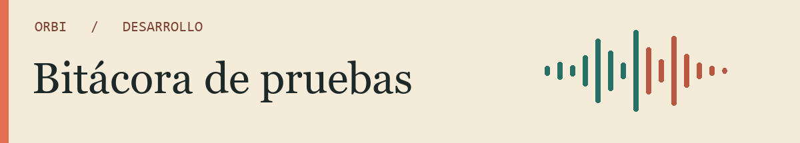

# Bitácora del prototipo

**Corte del 23 de noviembre de 2026** · [Volver a ORBI](README.md)

## Lo que pasó en el aparato

| Prueba | Resultado observado |
| --- | --- |
| Captura y reproducción local | En las primeras pruebas solo se oía el pitido. Tras ajustar el micrófono se pudo entender la frase grabada por el parlante. |
| Conversación completa | Con el canal de voz preparado, el usuario pulsó el botón, pidió una respuesta de una palabra y escuchó «listo» completo en el ORBI. |
| Respuesta larga | Una explicación que antes se cortaba llegó al final después de ajustar la recuperación del canal. Queda por medir la repetibilidad en una serie de turnos. |
| Controles físicos | El botón inferior abrió y cerró Ajustes. Se comprobó el uso del botón superior para hablar, encender el aparato después del apagado y despertar la pantalla. |
| Ahorro de energía | Con el modo ahorro activo, la pantalla entró en reposo a los cinco minutos y despertó con la primera pulsación. |
| Búsqueda cercana | Se escucharon los cuatro pulsos del localizador con volumen creciente. |

## Cambios que todavía hay que medir

- **Captura de hasta 15 segundos.** Se preparó el firmware con el nuevo límite. Falta verificar un turno completo de esa duración en el conjunto teléfono–aparato.
- **Reconocimiento en español.** Estamos evaluando un cambio de transcripción. Queremos comparar con las mismas frases cuántas palabras reconoce bien y cuánto tarda.
- **Continuidad del enlace.** Una prueba pendiente consiste en alternar diez preguntas cortas y respuestas largas. Vamos a registrar los cortes, las reconexiones y el tiempo hasta el primer sonido.
- **Contexto entre preguntas.** En pruebas consecutivas el asistente no siempre recordó el dato del turno anterior. La continuidad de conversación sigue en evaluación.

Una prueba individual documenta lo que ocurrió en ese equipo. Para comunicar resultados de rendimiento publicaremos también las condiciones, la cantidad de intentos y las mediciones.
