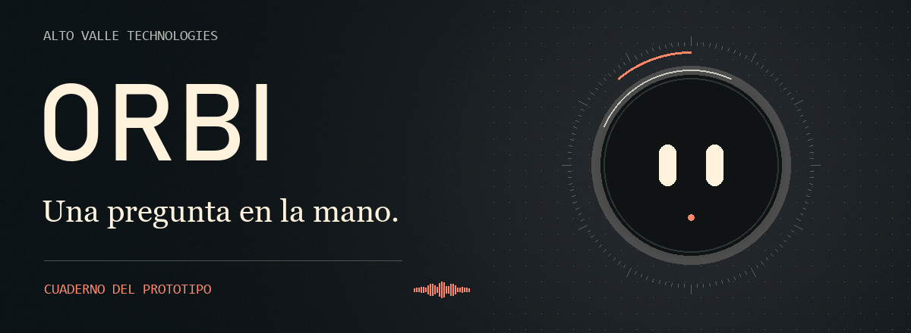
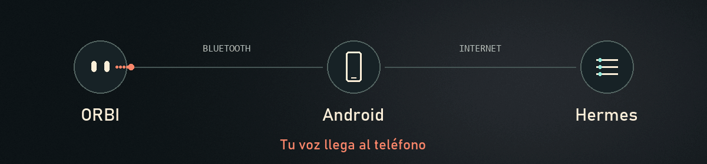
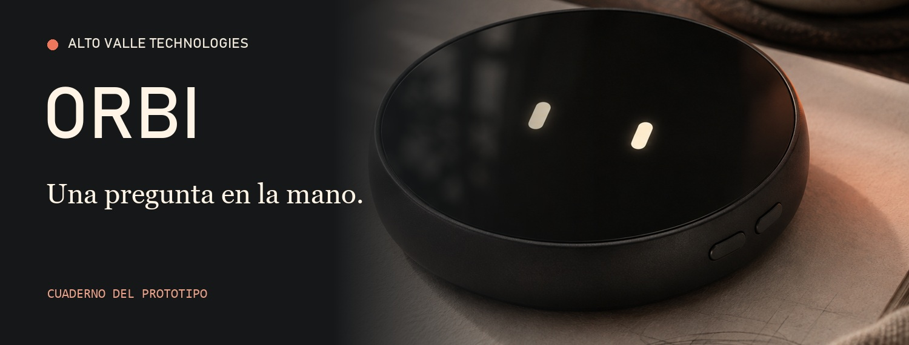

# ORBI

**ORBI es un asistente de voz que se usa desde la palma de la mano.** Mantenés presionada la pantalla o el botón superior, hacés una pregunta y soltás. La respuesta sale por el parlante del propio ORBI. Lo desarrollamos en Alto Valle Technologies, en la Patagonia argentina.

[Ver el sitio de ORBI](https://orbiconnect.app/) · [Leer la bitácora](BITACORA.md) · [Conocer Alto Valle Technologies](https://altovalletechnologies.com/)

## ORBI en Somos el Valle

En la cobertura de la Expo del CET N.º 1 de General Roca, Sebastián Bagli Barrera conversó con Somos el Valle sobre ORBI, el asistente de bolsillo que se vincula con el teléfono.

[Ver la entrevista en Instagram](https://www.instagram.com/reel/Df71eTWNeSX/)

## Qué pasa cuando hablás

| Momento | Qué hace ORBI |
| --- | --- |
| **Presionás** | El micrófono del aparato empieza a captar tu voz. El botón físico permite iniciar el mismo gesto que la pantalla táctil. |
| **Hablás y soltás** | ORBI envía el audio por Bluetooth al teléfono. ORBI Connect lo transcribe en español y manda el texto al asistente en la nube. |
| **Escuchás** | Hermes devuelve el texto de la respuesta. Android lo convierte en voz y lo envía al parlante del aparato por Bluetooth. |

El teléfono cumple dos funciones distintas. Procesa la voz localmente y aporta la conexión a internet para consultar al asistente. Las pruebas del recorrido completo se hicieron con ORBI Connect abierta.

## El aparato, de cerca

El prototipo usa una **ESP32-S3 Touch AMOLED de 1,75 pulgadas**, con pantalla circular, micrófono y parlante. Los ojos en pantalla forman parte de la interfaz. Al preparar la voz y establecer el enlace, se abren.

- **Botón superior.** Mantenelo presionado para hablar. También despierta la pantalla cuando el aparato está en reposo.
- **Botón inferior.** Un toque abre Ajustes y otro lo cierra. Desde ahí podés regular brillo y volumen, reiniciar ORBI o apagarlo.
- **Energía.** El modo estándar mantiene el comportamiento habitual. El modo ahorro reduce el brillo y pone la pantalla en reposo después de cinco minutos de inactividad.
- **Encontrar mi ORBI.** Si está encendido y al alcance de Bluetooth, podés hacerlo sonar desde el teléfono. Emite cuatro pulsos que suben de volumen.

## ORBI Connect en Android

| Pestaña | Para qué sirve |
| --- | --- |
| **Inicio** | Consultar el estado del dispositivo y acceder a Encontrar mi ORBI. |
| **Agente** | Configurar la personalidad, las instrucciones y las preferencias que querés darle a tu asistente. |
| **Ajustes** | Vincular la cuenta, revisar el enlace Bluetooth y preparar el canal de voz. |

La cuenta vinculada y el canal de voz son dos estados distintos. Comprobamos esa diferencia durante las pruebas: la app podía reconocer al titular mientras el aparato seguía en espera. La prueba que cierra el recorrido es hablarle al equipo y escuchar la respuesta completa por su parlante.

## Qué estamos afinando

El desafío actual es que **el décimo turno funcione tan bien como el primero**. Nos interesa cuánto pasa desde que soltás el botón hasta que se oye la primera palabra, si una explicación larga llega hasta el final y qué tan bien se entiende lo que dijiste.

En la [bitácora del prototipo](BITACORA.md) registramos las pruebas físicas, los resultados parciales y las preguntas que siguen abiertas. Para consultas sobre el proyecto, escribinos a [Alto Valle Technologies](mailto:altovalletechnologies@gmail.com).
